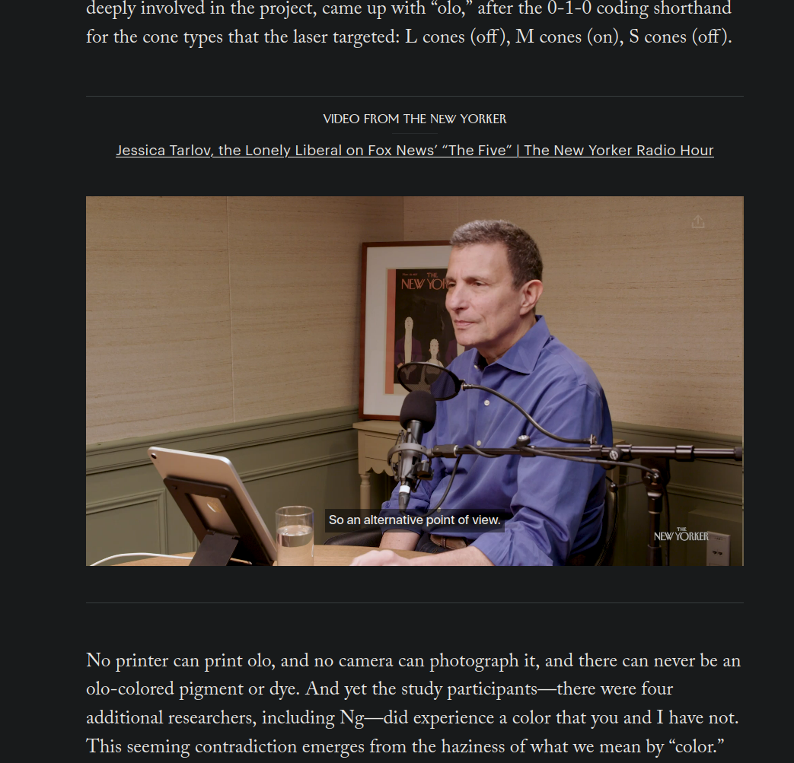
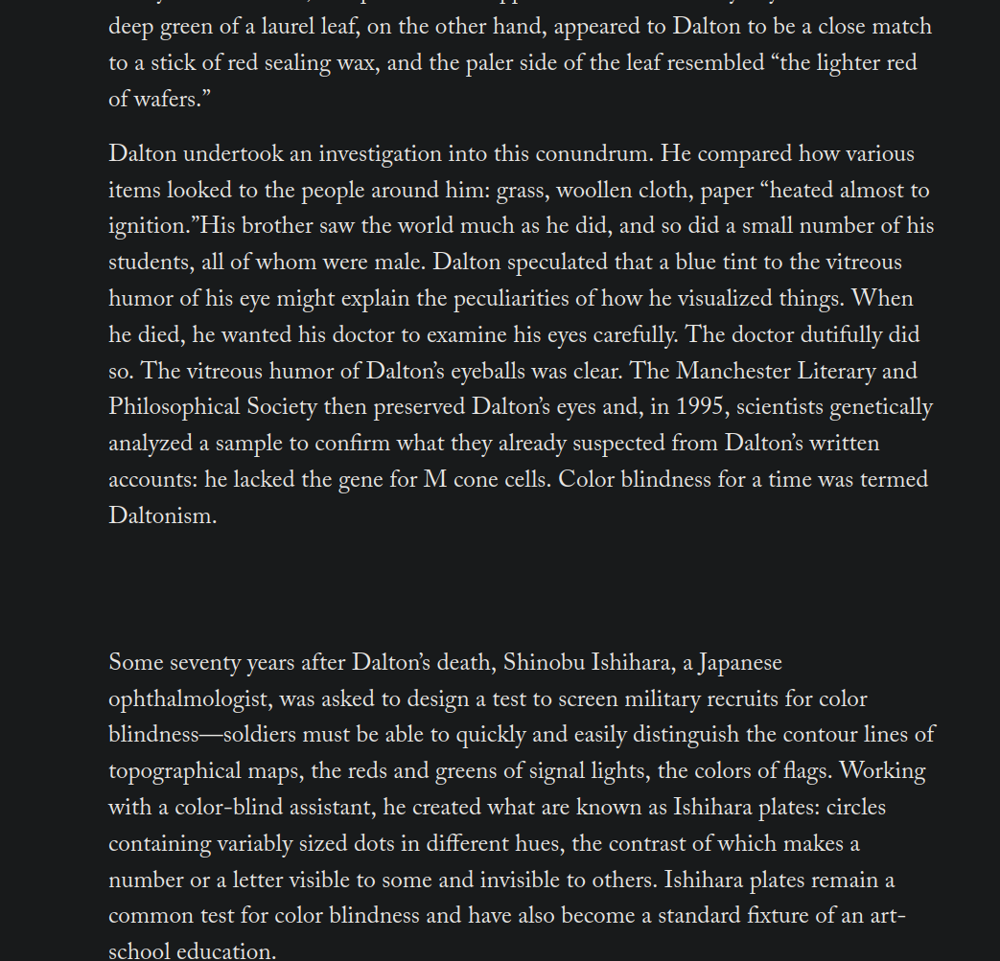

# New Yorker Focus

A small Firefox extension that hides the promo videos and cartoons dropped into
articles on [newyorker.com](https://www.newyorker.com), so you can read without
distractions.


## Screenshots

| Without the extension | With the extension |
| --- | --- |
|  |  |


## What it hides

- **Promo videos**: the Condé Nast "interlude" player, inline video embeds,
  the floating sticky player, and any `<video>` or `cnevids.com` iframe in the page.
- **Cartoons** placed between paragraphs.

Hidden videos are also paused and muted, so nothing plays in the background.

## What it leaves alone

- **The article's own lead image or video** at the top of the page
  (`ContentHeaderLeadAsset`).
- **Cartoon pages** (`/cartoons/...`): there the cartoon *is* the content.
- **Video pages** (`/video/...`): there the video *is* the content.

## Usage

Click the **NY** toolbar button to turn the extension on or off. The badge shows
**ON** (green) or **OFF** (grey). The setting is saved and takes effect right away
in every open New Yorker tab, with no reload needed.

## Install

The extension is built for Firefox 121 or later (Manifest V3).

**Temporary install (for development):**

1. Open `about:debugging#/runtime/this-firefox`.
2. Click **Load Temporary Add-on…** and select `manifest.json` from this folder.

Temporary add-ons are removed when Firefox restarts.

**Permanent install:** package and sign the extension through
[addons.mozilla.org](https://addons.mozilla.org/developers/) (it can be signed as
unlisted), or use [`web-ext`](https://github.com/mozilla/web-ext):

```sh
npx web-ext build      # creates a .zip in web-ext-artifacts/
npx web-ext run        # launches Firefox with the extension loaded
```

## How it works

| File | Role |
| --- | --- |
| [`manifest.json`](manifest.json) | Extension manifest; runs only on `*.newyorker.com`. |
| [`content.js`](content.js) | Injected at `document_start`. Adds a stylesheet that hides matching elements while `<html>` has the `nyf-on` class, and pauses or mutes any hidden video, including ones added later (via a `MutationObserver`). |
| [`background.js`](background.js) | Handles the toolbar button: flips the `enabled` flag in `storage.local` and updates the badge. Content scripts listen for the change. |
| [`icons/icon.svg`](icons/icon.svg) | Toolbar icon. |

If the site changes its markup and something slips through, add a selector to
`VIDEO_RULES` or `CARTOON_RULES` in `content.js`.

## Privacy

The extension collects no data and makes no network requests. Its only
permission besides access to newyorker.com is `storage`, which holds the on/off setting.
